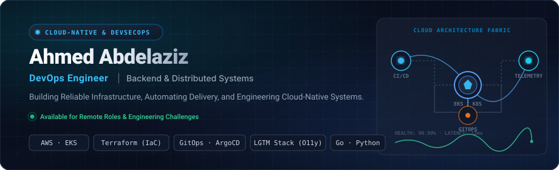
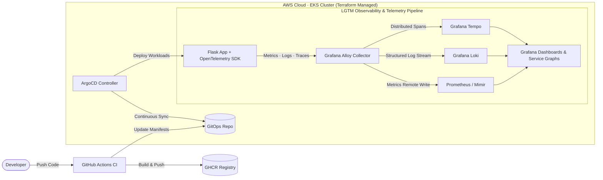
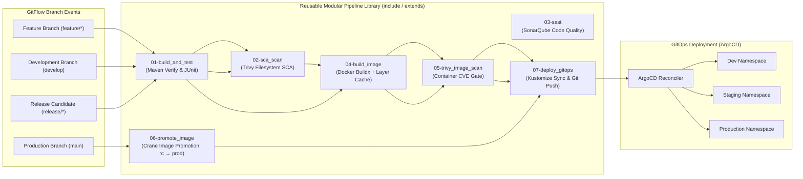

<div align="center">

<!-- Hero Banner -->


<br/>

<!-- Typing Headline -->
<a href="https://github.com/aaboelala">
  
</a>

<p align="center">
  <strong>Building Reliable Infrastructure, Automating Delivery, and Engineering Cloud-Native Systems.</strong>
</p>

<p align="center">
  <a href="https://github.com/aaboelala">
    
  </a>
  <a href="mailto:aaboelala461@gmail.com">
    
  </a>
  
  
</p>

---

</div>

## 📌 About Me

I am a **DevOps Engineer** with strong foundations in **Backend Engineering and Distributed Systems**. My engineering focus centers on bridging software development and cloud operations through automation, resilient architecture, and rigorous security practices.

- ☁️ **Cloud-Native Infrastructure:** Provisioning reliable, scalable environments on **AWS** using **Terraform** and **Kubernetes (EKS)**.
- 🔁 **CI/CD & GitOps:** Engineering modular, reusable deployment pipelines with **GitHub Actions**, **GitLab CI**, **Jenkins**, and **ArgoCD**.
- 🛡️ **DevSecOps & Shift-Left Security:** Enforcing container image security, static analysis, and supply chain integrity using **Trivy**, **SonarQube**, and rootless container builds.
- 🔭 **Unified Observability:** Implementing deep telemetry across metrics, logs, and distributed traces with the **LGTM Stack** (Loki, Grafana, Tempo, Mimir/Prometheus) and **OpenTelemetry**.
- ⚙️ **Backend & Systems:** Designing distributed backend services in **Go** and **Python**, applying event-driven architecture, gRPC inter-service communication, and transactional consistency patterns.

I view infrastructure as software: version-controlled, auditable, testable, and automated end-to-end.

---

## 🛠️ Technical Arsenal

### Core Technologies in Active Practice

<table>
  <thead>
    <tr>
      <th width="28%">Domain</th>
      <th width="40%">Technologies &amp; Tools</th>
      <th width="32%">Engineering Application</th>
    </tr>
  </thead>
  <tbody>
    <tr>
      <td><strong>Cloud &amp; Infrastructure</strong></td>
      <td>
        
        
        
      </td>
      <td>IaC provisioning, S3/DynamoDB remote state locking, VPC networking, Linux system administration.</td>
    </tr>
    <tr>
      <td><strong>Containers &amp; Orchestration</strong></td>
      <td>
        
        
        
      </td>
      <td>Cluster scheduling, Helm chart management, K8s RBAC, network policies, ephemeral build agents.</td>
    </tr>
    <tr>
      <td><strong>CI/CD &amp; GitOps</strong></td>
      <td>
        
        
        
        
      </td>
      <td>Reusable pipeline templates (<code>include</code>/<code>extends</code>), declarative GitOps reconciliation, GitFlow promotion.</td>
    </tr>
    <tr>
      <td><strong>DevSecOps &amp; Security</strong></td>
      <td>
        
        
        
      </td>
      <td>SCA &amp; container image vulnerability gates, SAST code analysis, rootless image generation, Skopeo transfers.</td>
    </tr>
    <tr>
      <td><strong>Configuration Management</strong></td>
      <td>
        
      </td>
      <td>Automated node provisioning, environment drift prevention, configuration playbooks.</td>
    </tr>
    <tr>
      <td><strong>Observability &amp; Telemetry</strong></td>
      <td>
        
        
        
        
        
      </td>
      <td>LGTM stack deployment, Grafana Alloy telemetry agent, p95/p99 latency tracking, service trace graphs.</td>
    </tr>
    <tr>
      <td><strong>Backend Engineering</strong></td>
      <td>
        
        
        
        
      </td>
      <td>Go microservices (Fiber v2), Protobuf/gRPC inter-service RPCs, RESTful API architecture, JWT authority.</td>
    </tr>
    <tr>
      <td><strong>Messaging &amp; Storage</strong></td>
      <td>
        
        
      </td>
      <td>Transactional Outbox Pattern, reliable topic exchange routing, relational schema design &amp; migrations.</td>
    </tr>
  </tbody>
</table>

---

## 🚀 Featured Engineering Projects

### 01. Cloud Infrastructure & Full-Stack Observability Platform
> **Automated AWS EKS provisioning paired with an enterprise LGTM observability stack and GitOps continuous delivery.**

[](https://github.com/aaboelala/observability_proj)
[](https://github.com/aaboelala/observability_proj)
[](https://github.com/aaboelala/observability_proj)
[](https://github.com/aaboelala/observability_proj)



- **Architecture Highlights:**
  - Fully automated AWS EKS cluster, VPC, and networking provisioning through modular **Terraform**, backed by S3 remote state storage and DynamoDB distributed state locking.
  - End-to-end telemetry pipeline powered by **Grafana Alloy**, collecting traces, logs, and metrics directly from instrumented container workloads.
  - Golden Signal monitoring in **Grafana**: Real-time RPS breakdowns, latency histograms (p95/p99), automated error rate detection, and distributed trace service graphs via **Tempo**.
  - **GitOps delivery via ArgoCD**: Declaratively reconciles application manifests against Git repository state with automated self-healing.
- **Repository:** [`aaboelala/observability_proj`](https://github.com/aaboelala/observability_proj)

---

### 02. Centralized CI/CD & DevSecOps Platform
> **Reusable, modular GitLab CI template ecosystem enforcing GitFlow, Shift-Left security, and automated GitOps promotions.**

[](https://gitlab.com/flight-platform/flight-platform-ci)
[](https://gitlab.com/flight-platform/flight-platform-docs)
[](https://gitlab.com/flight-platform/flight-platform-ci)



- **Architecture Highlights:**
  - **Single Source of Truth:** A modular CI/CD template architecture using native GitLab `include: local:`, `extends`, and `!reference` patterns to eliminate duplicate pipeline code across services.
  - **Shift-Left Security:** Automated early-stage Software Composition Analysis (SCA) via **Trivy filesystem scans** alongside container image vulnerability gates blocking high/critical CVEs.
  - **Optimized Image Lifecycles:** Utilizes **Docker Buildx** with distributed layer caching; promotes immutable image artifacts between environments (dev &rarr; staging &rarr; production) using **Crane** without redundant rebuilds.
  - **Automated GitOps Sync:** Pipeline stages update environment-specific Kustomize overlays, triggering **ArgoCD** deployments across isolated Kubernetes namespaces.
- **Repository Links:**
  - [GitLab CI Pipeline Engine](https://gitlab.com/flight-platform/flight-platform-ci)
  - [Platform Architecture Documentation](https://gitlab.com/flight-platform/flight-platform-docs)

---

### 03. Tarieky (طريقي) — End-to-End Application Delivery Platform
> **Civic road incident platform backed by Django REST Framework, hardened Jenkins on Kubernetes, rootless BuildKit, and ArgoCD.**

```mermaid
flowchart LR
    DevPush([Developer Git Push]) --> Jenkins["Jenkins on Kubernetes<br/>(Ephemeral Dynamic Pod Agents)"]
    
    subgraph HardenedCI ["Hardened In-Cluster CI Pipeline"]
        direction TB
        T1["Test & Coverage Suite (Min 70% Gate)"]
        T2["SonarQube SAST & Code Quality Gate"]
        T3["Trivy Filesystem SCA Dependency Scan"]
        T4["Rootless BuildKit (buildctl daemonless)"]
        T5["Trivy Image Scan (HIGH/CRITICAL Gates)"]
        T6["Skopeo Direct Push to GHCR"]
        T7["Automated K8s Manifest Tag Commit"]
        
        T1 --> T2
        T1 --> T3
        T2 --> T4
        T3 --> T4
        T4 --> T5
        T5 --> T6
        T6 --> T7
    end

    subgraph RuntimeK8s ["Hardened Kubernetes Runtime"]
        direction TB
        ArgoCD["ArgoCD GitOps Sync"]
        Workload["Django REST Pods (Non-root, Seccomp)"]
        DB[(Neon PostgreSQL)]
        FCM["Firebase Cloud Messaging"]
        
        ArgoCD --> Workload
        Workload --> DB
        Workload --> FCM
    end

    Jenkins --> HardenedCI
    T7 --> ArgoCD
```

[](https://github.com/aaboelala/tarieky)
[](https://github.com/aaboelala/tarieky)
[](https://github.com/aaboelala/tarieky)
[](https://github.com/aaboelala/tarieky)



- **Architecture Highlights:**
  - **Dynamic Ephemeral CI Agents:** Jenkins running natively on Kubernetes, dynamically spawning sandboxed build agents that terminate upon stage completion to minimize idle cluster resource usage.
  - **Rootless & Socketless Container Builds:** Employs **BuildKit daemon (`buildctl`) in rootless mode**, eliminating the requirement to mount Docker daemon sockets (`/var/run/docker.sock`) into build pods.
  - **Daemonless Registry Transfers:** Utilizes **Skopeo** to inspect, sign, and copy built image tarballs directly to GitHub Container Registry (GHCR).
  - **Kubernetes Security Hardening:** Strict `jenkins` namespace isolation with RBAC least-privilege, network policies restricting egress traffic, and enforcement of non-root execution (`runAsUser: 1000`) with dropped Linux capabilities (`drop: ["ALL"]`) and `RuntimeDefault` seccomp profiles.
- **Repository:** [`aaboelala/tarieky`](https://github.com/aaboelala/tarieky)

---

### 04. Distributed Microservices & Event-Driven E-Commerce Platform
> **Distributed microservices architecture in Go and Python showcasing synchronous gRPC, RabbitMQ event streaming, and the Transactional Outbox Pattern.**

[](https://github.com/aaboelala/go-microservice-learning)
[](https://github.com/aaboelala/go-microservice-learning)
[](https://github.com/aaboelala/go-microservice-learning)
[](https://github.com/aaboelala/go-microservice-learning)

```mermaid
flowchart TB
    Client([HTTP / API Client])

    subgraph Services ["Microservices Architecture"]
        US["User Service<br/>Go · Fiber v2<br/>:8080 (Sole JWT Authority)"]
        PS["Product Service<br/>Go · Fiber + gRPC Server<br/>:8081 / :50051"]
        OS["Order Service<br/>Go · Fiber<br/>:8082"]
        NS["Notification Service<br/>Python · Django/DRF<br/>:8000"]
    end

    subgraph Databases ["Database-Per-Service Pattern"]
        UDB[("users_db<br/>PostgreSQL")]
        PDB[("products_db<br/>PostgreSQL")]
        ODB[("orders_db<br/>PostgreSQL + outbox")]
        NDB[("notification_db<br/>PostgreSQL")]
    end

    subgraph Broker ["Message Broker"]
        RMQ{{"RabbitMQ Topic Exchange<br/>order.events"}}
    end

    Client -->|REST| US
    Client -->|REST| OS
    Client -->|REST| NS

    US --- UDB
    PS --- PDB
    OS --- ODB
    NS --- NDB

    OS -->|gRPC :50051 (Stock & Price Validation)| PS
    OS -.->|"Transactional Outbox<br/>(order.created / order.cancelled)"| RMQ
    RMQ -->|"Async Consumer<br/>notification.order-events"| NS
```

- **Architecture Highlights:**
  - **Decoupled Service Topologies:** Database-per-service pattern using isolated PostgreSQL instances (`users_db`, `products_db`, `orders_db`, `notification_db`).
  - **Transactional Outbox Pattern:** Solves the distributed dual-write dilemma by persisting order mutations and event payloads within a single ACID transaction in `orders_db`, publishing to **RabbitMQ** via an asynchronous relay to guarantee at-least-once delivery.
  - **Hybrid Communication Protocols:** High-speed synchronous validation over **gRPC & Protocol Buffers** for stock availability and pricing snapshots between Order Service and Product Service; asynchronous event broadcasting across topic exchanges for downstream Notification consumption.
  - **Centralized Token Authority:** User Service acts as the sole issuer of HMAC-SHA256 JWTs; peer services independently authenticate incoming requests via shared cryptographic verification without central bottlenecks.
- **Repository:** [`aaboelala/go-microservice-learning`](https://github.com/aaboelala/go-microservice-learning)

---

## 🔭 Currently Exploring & Expanding

To continually sharpen my engineering toolkit and stay ahead of evolving cloud-native standards, I am actively deepening my expertise in:

<table>
  <thead>
    <tr>
      <th width="35%">Domain / Technology</th>
      <th width="65%">Focus Areas &amp; Objectives</th>
    </tr>
  </thead>
  <tbody>
    <tr>
      <td><strong>Red Hat OpenShift</strong></td>
      <td>Enterprise Kubernetes cluster architectures, Security Context Constraints (SCC), Operator lifecycles, and enterprise platform governance.</td>
    </tr>
    <tr>
      <td><strong>Advanced Linux Internals</strong></td>
      <td>Deep-dive into process lifecycles, memory management, cgroups v2, namespaces, and system performance profiling (eBPF, <code>perf</code>, <code>strace</code>).</td>
    </tr>
    <tr>
      <td><strong>Microsoft Azure</strong></td>
      <td>Azure Kubernetes Service (AKS), Azure Resource Manager (ARM/Bicep), managed identities, and hybrid-cloud topologies.</td>
    </tr>
    <tr>
      <td><strong>Platform Engineering</strong></td>
      <td>Internal Developer Platforms (IDP), self-service developer infrastructure, and reducing cognitive overhead for delivery teams.</td>
    </tr>
    <tr>
      <td><strong>Database Reliability &amp; Performance</strong></td>
      <td>PostgreSQL query optimization, high-availability replication topologies, connection pooling (PgBouncer), and distributed caching strategies.</td>
    </tr>
  </tbody>
</table>

---

## 🧭 How I Approach Engineering

```
01. Automate Repetitive Operational Work
    Manual interventions are technical debt. Any task performed more than twice should be scripted or codified.

02. Design for Failure, Not Just the Happy Path
    Networks partition, nodes drain, and dependencies degrade. Architect for graceful degradation and automated recovery.

03. Shift Security Left into the Delivery Pipeline
    Security is not an afterthought or a final checklist item; it is continuously tested across every commit, image build, and deployment.

04. Build Observable Systems by Default
    You cannot manage what you cannot see. Metrics, structured logs, and distributed traces must be first-class citizens.

05. Enforce Reproducible Infrastructure
    If an environment cannot be rebuilt identically from code within minutes, it is not truly production-ready.

06. Understand the Engineering Problem Before Choosing the Tool
    Adopt technologies to address concrete constraints and clear operational requirements, not industry hype.
```

---

## 📊 GitHub Analytics

<div align="center">
  <table border="0">
    <tr>
      <td>
        
      </td>
      <td>
        
      </td>
    </tr>
  </table>
</div>

---

## 📬 Contact & Professional Links

I welcome discussions regarding **DevOps Engineering**, **Cloud Infrastructure**, **Platform Engineering**, and **Distributed Systems**.

<div align="center">

[](https://github.com/aaboelala)
[](mailto:aaboelala461@gmail.com)
<!-- Note: To add LinkedIn, provide verified handle: https://linkedin.com/in/your-profile -->

<br/>
<sub>Designed with precision &bull; Built for reliability &bull; Continuous Delivery in practice</sub>

</div>
